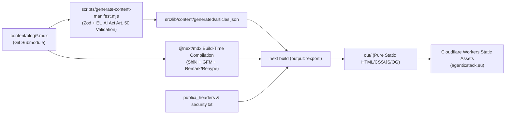

<div align="center">

<picture>
  <source media="(prefers-color-scheme: dark)" srcset="public/logo/full-dark.png" />
  <source media="(prefers-color-scheme: light)" srcset="public/logo/full-light.png" />
  
</picture>

### Engineering the transition from DevSecOps to Agentic Engineering.

[](https://github.com/domehahn/agenticstack/actions/workflows/ci.yml)
[](https://agenticstack.eu)
[](https://nextjs.org)
[](https://www.typescriptlang.org)
[](https://developers.cloudflare.com/workers/static-assets/)
[](docs/compliance/editorial-ai-policy.md)
[](LICENSE)

[**Live Publication**](https://agenticstack.eu) · [**Editorial AI Policy**](docs/compliance/editorial-ai-policy.md) · [**Compliance Docs**](docs/compliance/README.md) · [**Security Policy**](SECURITY.md) · [**Contributing**](CONTRIBUTING.md)

</div>

---

## Overview

**AgenticStack** ([agenticstack.eu](https://agenticstack.eu)) is a production-grade technical publication exploring how AI agents, DevSecOps, software architecture, security, platforms, and engineering methodology converge into a single discipline.

The application is engineered as a **pure static export** (`output: "export"`) built with Next.js 16 (App Router), strict TypeScript, Tailwind CSS v4, and build-time MDX compilation, deployed directly to Cloudflare's edge static-assets layer with zero server-side runtime dependencies.

---

## Architecture & Content Pipeline



### Repository Layout

```text
├── content/blog/        # Git submodule → github.com/domehahn/agentic-devsecops
├── docs/compliance/     # EU AI Act Art. 50 policy, RFC 9116 & Cloudflare audit docs
├── e2e/                 # Playwright end-to-end test suite
├── public/
│   ├── .well-known/     # RFC 9116 security.txt
│   ├── _headers         # Cloudflare static-assets security & TDM headers
│   └── logo/            # Light/dark brand logos, icons, and favicons
├── scripts/
│   ├── cloudflare-audit.mts          # Cloudflare zone compliance audit & remediation tool
│   ├── generate-content-manifest.mjs # Build-time MDX frontmatter validator & indexer
│   └── publish-content.sh            # Submodule sync, build & Cloudflare deploy script
└── src/
    ├── app/             # Next.js App Router (static pages, OG images, sitemap, robots)
    ├── components/      # Layout, navigation, MDX callouts, cmdk search, blog UI
    ├── config/          # Central site, topic, author, and navigation definitions
    ├── lib/             # Content queries, Zod schema, TOC extractor, search, SEO/JSON-LD
    └── types/           # Domain models
```

### Key Engineering Decisions

1. **Zero Runtime Filesystem or `eval()`:**
   - [`scripts/generate-content-manifest.mjs`](scripts/generate-content-manifest.mjs) walks `content/blog/**/*.mdx` at build time, validates frontmatter against Zod and EU AI Act Art. 50 rules, and emits `src/lib/content/generated/articles.json`.
   - Article bodies are compiled at build time via `@next/mdx` dynamic imports rather than runtime `next-mdx-remote`, eliminating runtime `eval()` and shipping static HTML directly from Cloudflare's edge.
2. **Server/Client Search Split:**
   - [`src/lib/search/index.ts`](src/lib/search/index.ts) builds the search index on the server at build time, while [`src/lib/search/query.ts`](src/lib/search/query.ts) ships a pure, dependency-free scoring function to the `cmdk` command palette.
3. **Security & Compliance by Default:**
   - **Hardened HTTP Headers ([`public/_headers`](public/_headers)):** Strict `Content-Security-Policy`, `Strict-Transport-Security` (HSTS preload), `X-Content-Type-Options: nosniff`, `X-Frame-Options: DENY`, `Referrer-Policy`, `Permissions-Policy`, and `tdm-reservation: 1` (EU DSM Directive Art. 4 Text and Data Mining opt-out).
   - **RFC 9116 Security Disclosure ([`public/.well-known/security.txt`](public/.well-known/security.txt)):** Machine-readable vulnerability disclosure endpoint.
   - **EU AI Act Art. 50 Transparency:** Enforced at build time in [`src/lib/content/schema.ts`](src/lib/content/schema.ts) for all articles dated `>= 2026-08-02`, rendered via [`src/components/blog/ai-disclosure.tsx`](src/components/blog/ai-disclosure.tsx).

---

## Getting Started

### 1. Clone with Submodules & Install

```bash
git clone --recurse-submodules git@github.com:domehahn/agenticstack.git
cd agenticstack
npm ci
```

*(If already cloned without `--recurse-submodules`, run `git submodule update --init --recursive`.)*

### 2. Development & Quality Gates

| Command | Description |
| :--- | :--- |
| `npm run dev` | Regenerates content manifest and starts Next.js local dev server |
| `npm run generate:content` | Validates `content/blog/**/*.mdx` frontmatter and writes `articles.json` |
| `npm run build` | Builds the production static export into `out/` |
| `npm run preview` | Builds and serves `out/` locally via `wrangler dev` |
| `npm run lint` | Runs ESLint across the repository |
| `npx tsc --noEmit` | Runs strict TypeScript type-checking |
| `npm test` | Runs Vitest unit tests (schema, content queries, TOC, search, slugs) |
| `npm run test:e2e` | Runs Playwright end-to-end browser tests |

---

## Publishing Articles

Articles live in the [`content/blog`](content/blog) submodule ([`domehahn/agentic-devsecops`](https://github.com/domehahn/agentic-devsecops)).

```bash
# 1. Create a new article from the template
cp content/blog/_template.mdx content/blog/my-new-article.mdx

# 2. Edit frontmatter (set draft: false, fill ai transparency block) & write MDX content
#    See content/blog/README.md for the full frontmatter & component reference.

# 3. Or pull latest articles from the content submodule and deploy in one step:
./scripts/publish-content.sh
```

---

## Deployment & Cloudflare Compliance

The site deploys to Cloudflare Workers Static Assets configured in [`wrangler.jsonc`](wrangler.jsonc) for `agenticstack.eu` and `www.agenticstack.eu`:

```bash
npm run deploy             # Builds static export to out/ and deploys via Wrangler
npm run production:audit   # Verifies live production HTTP security headers, TLS & security.txt
npm run cloudflare:audit   # Dry-run audit of Cloudflare zone settings (requires CLOUDFLARE_API_TOKEN)
```

---

## License

- **Application Source Code:** Licensed under the [MIT License](LICENSE).
- **Editorial Content & Brand Assets:** Copyright © Dominik Hahn. All Rights Reserved (`tdm-reservation: 1`).
