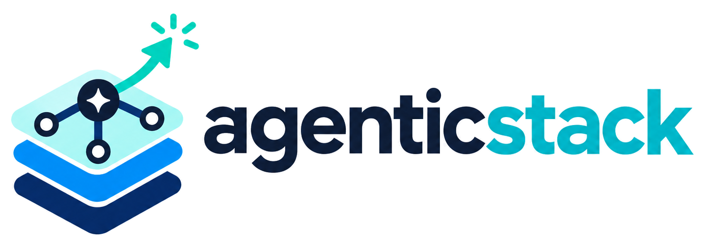

<div align="center">

<picture>
  <source media="(prefers-color-scheme: dark)" srcset="public/logo/full-dark.png" />
  <source media="(prefers-color-scheme: light)" srcset="public/logo/full-light.png" />
  
</picture>

### Personal technical blog on Agentic Engineering, DevSecOps, AI Agents & Platform Engineering.

[](https://github.com/domehahn/agenticstack/actions/workflows/ci.yml)
[](https://agenticstack.eu)
[](https://nextjs.org)
[](https://www.typescriptlang.org)
[](https://developers.cloudflare.com/workers/static-assets/)
[](LICENSE)

[**agenticstack.eu**](https://agenticstack.eu) · [**Editorial AI Policy**](docs/compliance/editorial-ai-policy.md) · [**Security Policy**](SECURITY.md)

</div>

---

## About

This repository contains the source code for **[agenticstack.eu](https://agenticstack.eu)** — my technical blog about the shift from DevSecOps and platform engineering toward agentic, AI-native software engineering.

- **Static-first:** Built with Next.js 16 (`output: "export"`), TypeScript, Tailwind CSS v4, and build-time `@next/mdx` compilation.
- **Edge-hosted:** Served directly as static assets on Cloudflare (`agenticstack.eu`) with zero server-side runtime overhead.
- **Decoupled content:** Blog posts live as `.mdx` files in the [`content/blog`](content/blog) Git submodule ([`domehahn/agentic-devsecops`](https://github.com/domehahn/agentic-devsecops)).

---

## Structure

```text
├── content/blog/        # Git submodule with all MDX blog posts & authoring guide
├── docs/compliance/     # EU AI Act Art. 50 transparency policy & Cloudflare audit docs
├── e2e/                 # Playwright end-to-end tests
├── public/
│   ├── .well-known/     # RFC 9116 security.txt
│   ├── _headers         # Cloudflare static-assets security & TDM headers
│   └── logo/            # Light/dark brand logos, icons, and favicons
├── scripts/
│   ├── cloudflare-audit.mts          # Cloudflare zone security & compliance check
│   ├── generate-content-manifest.mjs # Build-time MDX frontmatter validator & indexer
│   └── publish-content.sh            # Submodule pull, build & Cloudflare deploy helper
└── src/                 # Next.js App Router pages, components, search, SEO & tests
```

---

## Local Development

```bash
git clone --recurse-submodules git@github.com:domehahn/agenticstack.git
cd agenticstack
npm ci
npm run dev
```

### Commands

| Command | Description |
| :--- | :--- |
| `npm run dev` | Regenerates content manifest and starts local dev server |
| `npm run generate:content` | Validates `content/blog/**/*.mdx` frontmatter and generates `articles.json` |
| `npm run build` | Builds static export into `out/` |
| `npm run preview` | Builds and previews `out/` locally via `wrangler dev` |
| `npm run deploy` | Builds and deploys `out/` to Cloudflare (`agenticstack.eu`) |
| `npm run lint` | Runs ESLint |
| `npm test` | Runs Vitest unit tests |
| `npm run test:e2e` | Runs Playwright browser tests |

---

## Writing & Publishing Posts

1. Create a new post from [`content/blog/_template.mdx`](content/blog/_template.mdx) (see [`content/blog/README.md`](content/blog/README.md) for frontmatter and MDX components).
2. Commit and push inside `content/blog`, or run [`./scripts/publish-content.sh`](scripts/publish-content.sh) to pull new posts from the submodule, bump the pointer, and deploy to Cloudflare.

---

## License

- **Code:** [MIT License](LICENSE)
- **Blog Posts & Brand Assets:** Copyright © Dominik Hahn. All Rights Reserved (`tdm-reservation: 1`).
